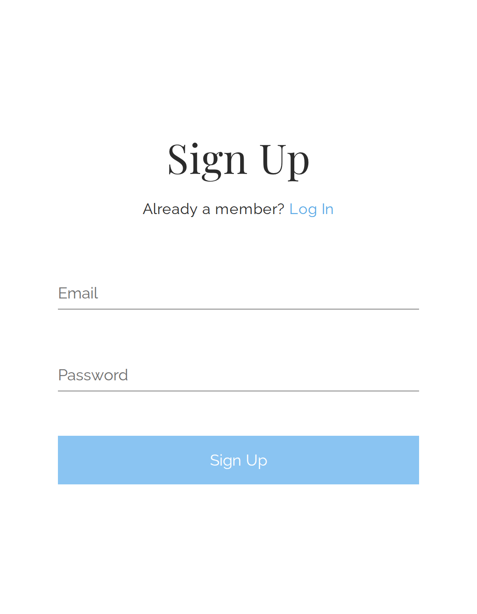
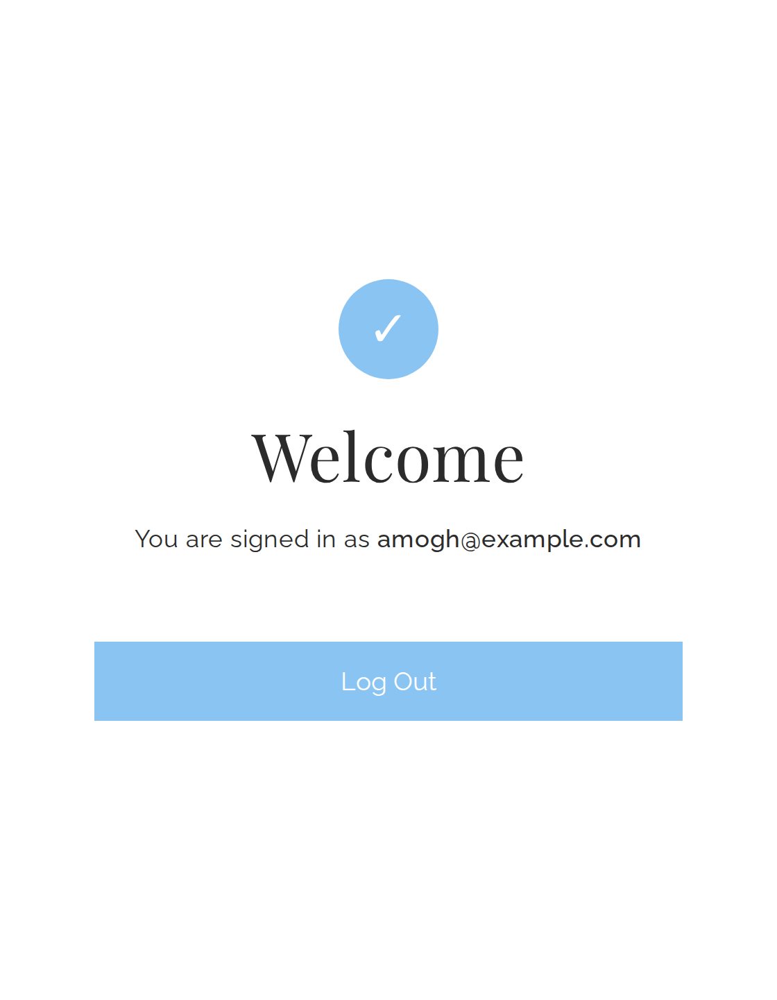
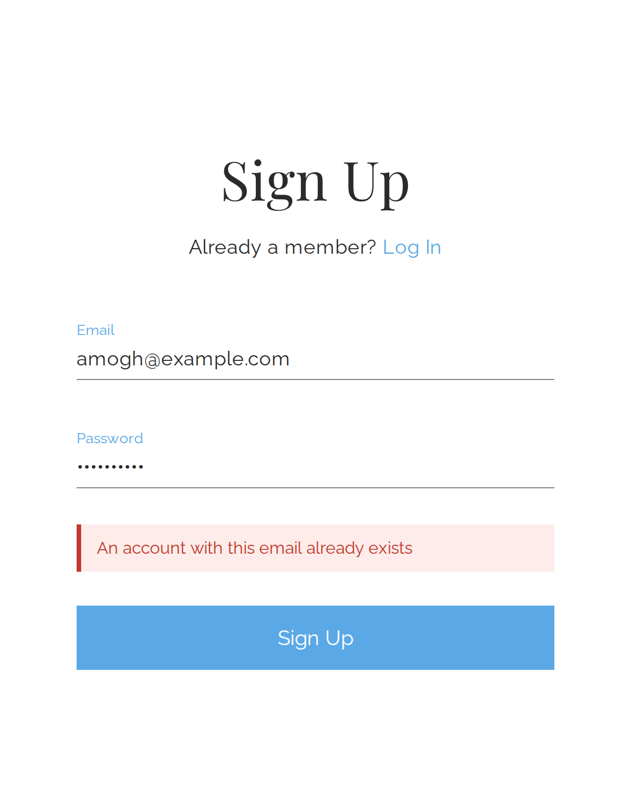
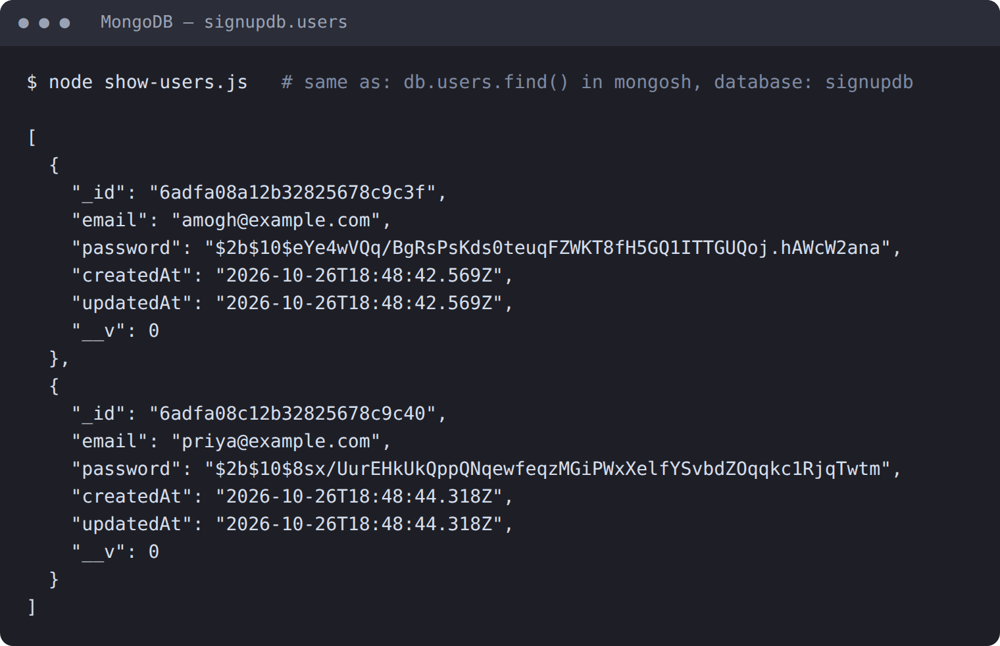

# Sign Up App (React + Express.js + REST API + MongoDB)

A sign-up (and log-in) flow built with the MERN stack. The React front end talks to an Express.js REST API, which stores users in MongoDB. Passwords are hashed with bcrypt before they are saved.

## Screenshots

### 1. Sign Up page


### 2. Sign up successful (signed in)


### 3. Sign up failed (email already registered)


### 4. Data stored in MongoDB after signing up


The same output as text (database `signupdb`, collection `users`):

```json
[
  {
    "_id": "6adfa08a12b32825678c9c3f",
    "email": "amogh@example.com",
    "password": "$2b$10$eYe4wVQq/BgRsPsKds0teuqFZWKT8fH5GQ1ITTGUQoj.hAWcW2ana",
    "createdAt": "2026-10-26T18:48:42.569Z",
    "updatedAt": "2026-10-26T18:48:42.569Z",
    "__v": 0
  },
  {
    "_id": "6adfa08c12b32825678c9c40",
    "email": "priya@example.com",
    "password": "$2b$10$8sx/UurEHkUkQppQNqewfeqzMGiPWxXelfYSvbdZOqqkc1RjqTwtm",
    "createdAt": "2026-10-26T18:48:44.318Z",
    "updatedAt": "2026-10-26T18:48:44.318Z",
    "__v": 0
  }
]
```

Note that the `password` field is a bcrypt hash, not the real password.

## Tech stack

| Layer     | Technology                         |
|-----------|------------------------------------|
| Front end | React 18 (Vite), plain CSS         |
| Back end  | Node.js, Express.js (REST API)     |
| Database  | MongoDB with Mongoose              |
| Security  | bcryptjs password hashing          |

## Project structure

```
signup-mern-app/
├── client/                 React front end
│   ├── index.html
│   ├── vite.config.js      dev server + proxy to the API
│   └── src/
│       ├── main.jsx
│       ├── App.jsx         sign up / log in form logic
│       └── styles.css      all styling
├── server/                 Express REST API
│   ├── server.js           app entry, MongoDB connection
│   ├── models/User.js      Mongoose user schema
│   ├── routes/auth.js      /signup and /login endpoints
│   ├── show-users.js       prints stored users
│   └── .env.example        environment variables template
├── screenshots/
└── package.json            helper scripts
```

## REST API

| Method | Endpoint           | Body                  | Success         | Errors                                   |
|--------|--------------------|-----------------------|-----------------|------------------------------------------|
| POST   | `/api/auth/signup` | `{ email, password }` | `201` + user    | `400` invalid input, `409` email exists  |
| POST   | `/api/auth/login`  | `{ email, password }` | `200` + user    | `400` missing fields, `401` bad login    |
| GET    | `/api/health`      | none                  | `200` `{status}`| none                                     |

## How to run

You need Node.js (v18 or newer) and MongoDB running locally (or a MongoDB Atlas connection string).

```bash
# 1. install everything
npm run install-all

# 2. create the server config file
#    Windows (cmd):   copy server\.env.example server\.env
#    Mac/Linux:       cp server/.env.example server/.env

# 3. start API and React together
npm run dev
```

Then open http://localhost:5173.

To see the stored users at any time:

```bash
cd server
node show-users.js
```
